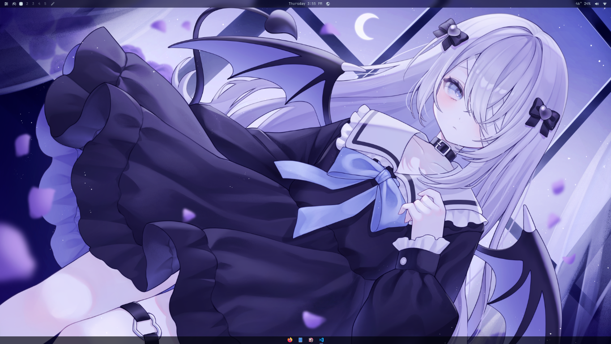
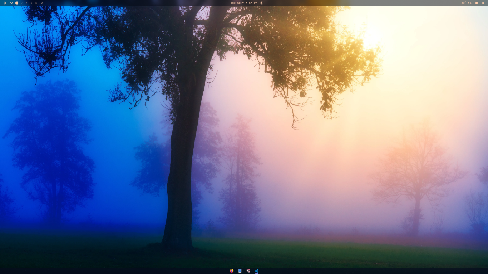
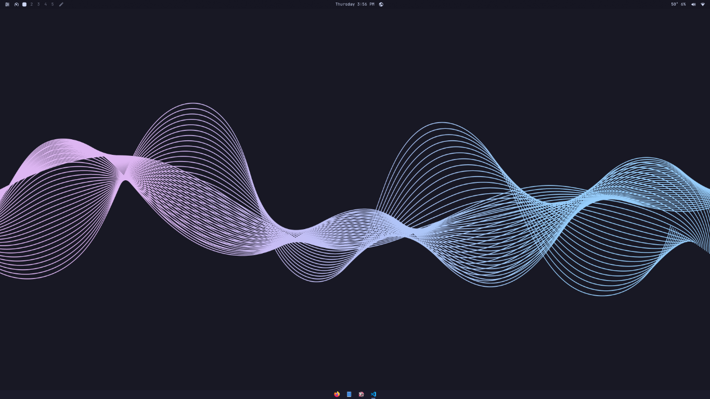

# FISHYLAYOUT

One private Omarchy shell plugin that groups the selected community features
behind a single bar icon and dashboard. It bundles:

- Plugin Manager
- Quick Drawer
- Omarchy Taskbar
- Workspace Peek
- GPU Monitor
- Cursor Accent
- Better Media
- Glass & Blur
- Glass Alt+Tab

The optional `omarchy-fx` plugin from the old installer is not included; it was
a separate add-on, not part of the main plugin list.

## Restore the original bar layout

The original shell layout preset is preserved at
`presets/current-layout.json`. Apply it explicitly with:

| Anime wallpaper | Misty forest | Abstract wave |
|---|---|---|
|  |  |  |

```bash
./presets/apply-current-layout.sh
```

The script replaces only the `bar` object in `~/.config/omarchy/shell.json`,
preserves other shell settings, and creates a uniquely named backup first.
You can apply the same preset using **Apply bar preset** in the FISHYLAYOUT
dashboard. The FISHYLAYOUT icon stays on the bar; the other third-party icons
appear only if their standalone plugins are installed.

The preset uses the original standalone widget IDs. Those widgets must still
be installed separately for the original multi-icon layout to render: this
single native plugin exposes one bar-widget ID and does not register each
bundled feature as an independent Omarchy widget.

## Install

For the single dashboard, run these commands on your Omarchy machine:

```bash
omarchy plugin add https://github.com/wwoooho2-gif/FISHYLAYOUT.git --enable
omarchy bar put furina.omarchy-suite
```

The plugin has one bar entry. Its dashboard opens the bundled controls; the
taskbar and Alt+Tab are loaded through the plugin's panel entry point.
Alt+Tab writes a generated Hyprland toggle loader under
`~/.local/state/omarchy/toggles/hypr/` when the panel loads. Delete that loader
and run `hyprctl reload` to restore Omarchy's built-in Alt+Tab behavior.
The cursor theme-follow hooks are opt-in. After installation, run:

```bash
~/.config/omarchy/plugins/furina.omarchy-suite/features/cursor-accent/tools/install-cursor-hook.sh
```

## Optional: OmaWarden

OmaWarden is a separate upstream plugin and is not installed with FISHYLAYOUT.
Install it only if you want Bitwarden controls:

```bash
omarchy plugin add https://github.com/salemsayed/omawarden.git --enable
```

It adds its own bar widget and is not required by the suite. The original
multi-icon layout preset references that widget, so install it before applying
the preset if you want OmaWarden in that layout.

## Notes

The original multi-icon preset refers to the upstream standalone plugin IDs.
It restores the layout configuration, but those standalone widgets must be
installed separately; this native bundle registers only its own dashboard
widget. Installing this bundle alone cannot recreate the old independent
bar icons.

Bundled source and its license/notice files are under `features/`:

| Feature | Upstream project |
|---|---|
| Plugin Manager | [fross100/omaplug](https://github.com/fross100/omaplug) |
| Quick Drawer | [KaplanHalil/omarchy-quick-drawer](https://github.com/KaplanHalil/omarchy-quick-drawer) |
| Taskbar | [gsus67/omarchy-taskbar](https://github.com/gsus67/omarchy-taskbar) |
| Workspace Preview | [AnoopLamba/omarchy-workspace-preview](https://github.com/AnoopLamba/omarchy-workspace-preview) |
| GPU Monitor | [candycrabmusic/gpu-monitor](https://github.com/candycrabmusic/gpu-monitor) |
| Cursor Accent | [SmoothPixels/cursor-accent](https://github.com/SmoothPixels/cursor-accent) |
| Better Media | [BibekBhusal0/omarchy-better-media](https://github.com/BibekBhusal0/omarchy-better-media) |
| Glass & Blur | [lutfi-zain/omarchy-glass-blur](https://github.com/lutfi-zain/omarchy-glass-blur) |
| Alt+Tab | [hugorolimf/omarchy-alttab](https://github.com/hugorolimf/omarchy-alttab) |

Licensing varies by feature; refer to each bundled `LICENSE` and `NOTICE.md`.

Some upstream features rely on Omarchy, Hyprland, or optional tools already
being available. Cursor Accent's automatic theme-follow behavior also needs
its upstream hook installer run once from this plugin's installed directory.

Plugins execute as your user inside the long-lived Omarchy shell. Review the
bundled source and its dependencies before enabling it.
